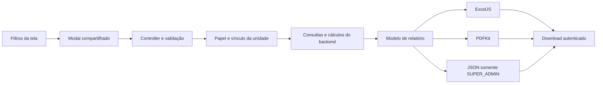

# Exportações web — 3.5.0

## Acesso e unidade

- USER com vínculo ACTIVE e papel OWNER/MANAGER: Excel (.xlsx) ou PDF, sempre na unidade selecionada no painel.
- OPERATOR, DELIVERY e contas sem vínculo autorizado: botão oculto e API bloqueada com 403.
- SUPER_ADMIN: Excel, PDF ou JSON; escolhe uma unidade no modal a cada abertura.
- A API verifica o vínculo no banco a cada exportação. O papel global não substitui o vínculo dos usuários comuns.
- “Meus dados” continua sendo a cópia dos dados da própria conta, incluindo atividades em outras unidades. A unidade escolhida determina a autorização; não muda a titularidade dos dados.
- Auditoria é exclusiva de SUPER_ADMIN. O arquivo contém apenas os eventos com o unit_id escolhido, sem eventos globais sem unidade.

## Fluxo

Nenhuma tabela ou migração é adicionada. Relatórios leem os dados existentes; sucesso e falha são registrados em audit_logs. Arquivos são gerados em memória e enviados com Cache-Control: no-store.

## Endpoints

| Rota | Uso |
| --- | --- |
| GET /exports/units | Lista de id/nome das unidades para o seletor do SUPER_ADMIN |
| GET /exports/review-products | Produtos avaliados da unidade autorizada; alimenta o filtro do modal |
| GET /exports/reports | unit_id, report, format e filtros do relatório |
| GET /users/me/export | unit_id e format; dados da conta autenticada |
| GET /audit-logs/export | unit_id, format e filtros de auditoria; SUPER_ADMIN |

report: finance, payments, orders, deliveries, catalog, performance, coupons, promotions, support ou reviews.

format: xlsx, pdf ou json. JSON é recusado para usuários comuns mesmo quando solicitado diretamente.

Os DTOs e o Swagger documentam os campos aceitos. O modal inicia com os filtros aplicados na tela e permite refiná-los sem mudar a listagem. Paginação da tela não limita o arquivo.

## Conteúdo e cálculos

| Relatório | Conteúdo e regra |
| --- | --- |
| Financeiro | Resumo, recebimentos por dia, formas de pagamento, despesas e acertos de entregas; reutiliza os casos de uso financeiros do painel, na mesma transação de leitura |
| Pagamentos | Pedidos e recebimentos no mês da criação do pedido; mesmas visões all/pending/receivable/refunds/issues da listagem; líquido recebido desconta taxas e estornos de pagamentos recebidos |
| Pedidos | Datas, cliente, situação, agendamento, subtotal, desconto, frete e total; filtros de pedido e agendamento independentes |
| Catálogo | Cadastro, preço, disponibilidade, quantidade e mínimo do estoque existente; nenhum novo controle de estoque |
| Desempenho | Quantidade e valor bruto dos itens de pedidos DELIVERED com pagamentos PAID/PARTIALLY_REFUNDED; sem frete e sem rateio dos descontos do pedido; não representa receita líquida |
| Cupons | Cupons locais e globais aplicáveis; utilizações e descontos somente da unidade, com resgates REDEEMED |
| Promoções | Campanha, produto, vigência, desconto e preço promocional |
| Entregadores | Pessoas vinculadas à unidade, situação do vínculo e perfil, modalidade e disponibilidade |
| Atendimento | Todos os solicitantes com chamados vinculados à unidade; protocolo, assunto, categoria, prioridade, situação e datas |
| Avaliações | Avaliações da unidade e produtos, notas, comentários, datas e nota média do conjunto filtrado |

Horários são apresentados em America/Sao_Paulo. Datas finais de filtros incluem o dia inteiro. Todo relatório usa o mesmo template MeatShop: identidade visual vermelha, identificação da unidade ou pessoa, data de geração, filtros, cabeçalhos repetidos e estado vazio explícito. Excel mantém valores monetários e quantidades como números, aplica larguras proporcionais, bordas, faixas alternadas, filtro, cabeçalho congelado e configuração de impressão. PDF repete contexto e cabeçalho nas páginas, inclui bordas e paginação; relatórios com mais de oito colunas usam A3 paisagem e fonte adaptativa. Valores textuais no Excel são strings, não fórmulas.

No relatório de avaliações, a lista de produtos é carregada da unidade selecionada dentro do modal. Ao trocar a unidade como SUPER_ADMIN, o filtro volta para “Todas” e as opções são buscadas novamente, evitando reaproveitar produtos da unidade exibida na tela.

## Limites e erros

Consultas detalhadas recusam resultados acima de 10.000 linhas por seção com HTTP 413 e orientação para refinar filtros; não truncam silenciosamente. A geração também recusa conteúdo-fonte acima de 8 MB, células acima de 30 mil caracteres e arquivo final acima de 25 MB. Dados pessoais usam limite de 10.000 campos exportados. Datas inválidas ou invertidas são recusadas. Falhas inesperadas retornam mensagens em português e são registradas sem conteúdo do relatório.

“Meus dados pessoais” cobre perfil, endereços, compras, itens, pagamentos, transações, reembolsos, histórico de status, cupons utilizados, carrinho, avaliações, suporte, conversas, notificações, aceites legais, vínculos, dados do entregador, atribuições, rastreamento de localização, recusas, despesas, veículos, metas, avaliações e acertos do entregador, IA e eventos de auditoria da conta. Senhas, hashes, tokens, URLs sensíveis de checkout, segredos e textos antigos/novos de auditoria são removidos para não expor credenciais ou dados de terceiros.

O modal impede cliques duplicados, apresenta carregamento, permite tentar novamente e cancela a requisição quando o usuário muda de unidade ou sai da tela. O download usa o cliente HTTP existente, incluindo renovação de sessão e tratamento de erros.

## Validação

- Backend: npm run typecheck, npm run lint, npm test, npm run build.
- Web: npm run typecheck, npm run lint, npm test, npm run build.
- Os testes SQL usam PGlite, PostgreSQL em memória com dados sintéticos, sem acesso ao banco da aplicação. Jest roda com --experimental-vm-modules para carregar esse mecanismo.
- Testes de arquivos reabrem o XLSX e conferem números, datas, filtros e texto sem fórmula; verificam PDF vazio, tabelas longas e paginação.
- Os pacotes PDFKit e ExcelJS ficam apenas no backend. As dependências são fixadas nos manifests e lockfiles.

## Compatibilidade

A versão 3.5.0 é aplicada ao frontend e backend. O mobile 3.5.0 usa uma rota pessoal separada, exclusiva do entregador, sem unidade e sem papel OWNER/MANAGER. A rota administrativa de dados pessoais descrita aqui continua exigindo unit_id e format. Consulte [Exportações pessoais do entregador](./EXPORTACOES_MOBILE_3_5_0.md).

A nova interface de auditoria substitui CSV por Excel/PDF/JSON. Não há publicação ou commit automático.
