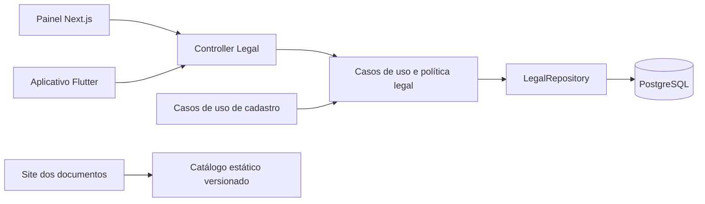
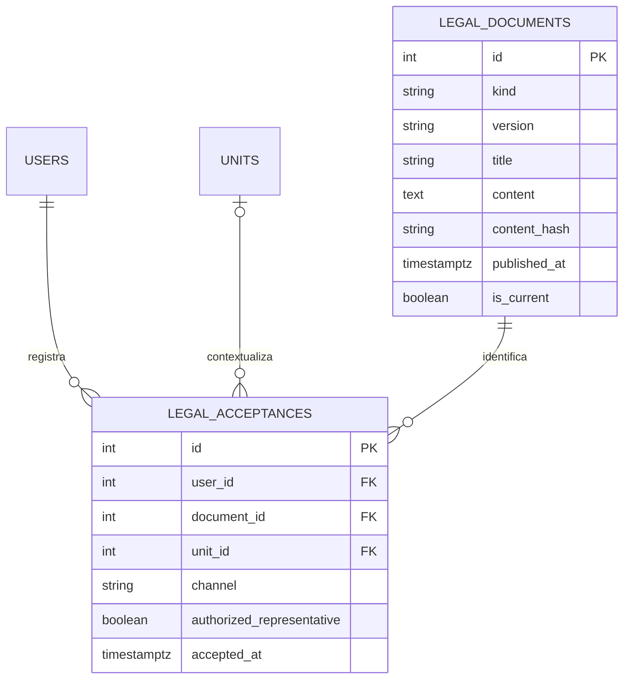
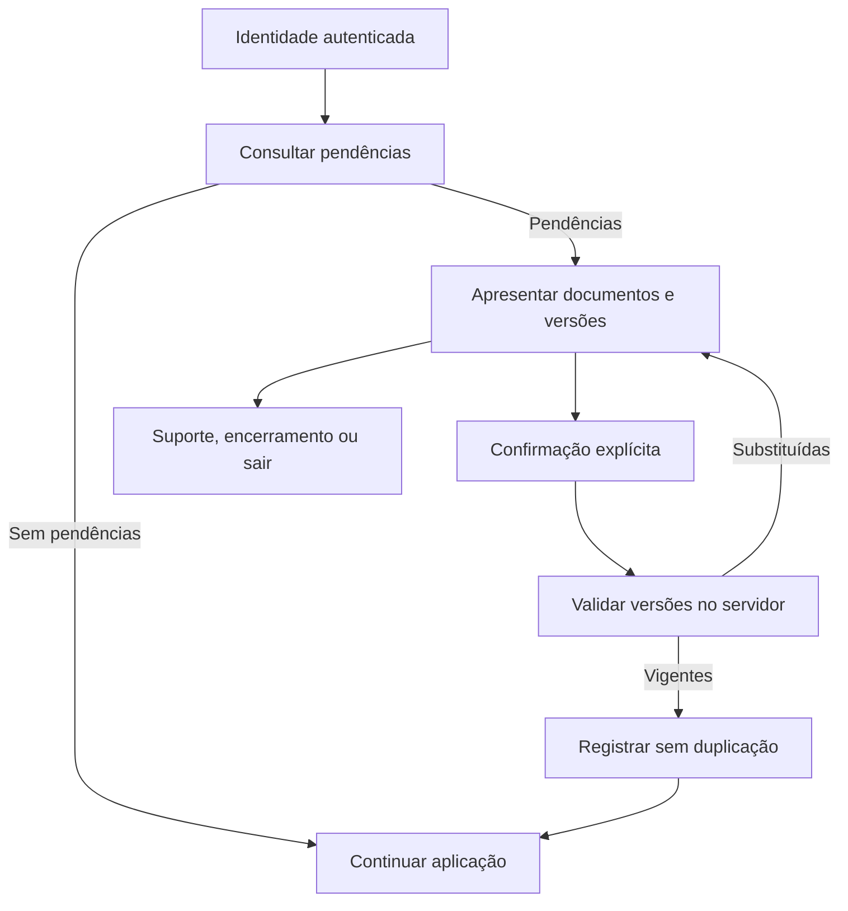

# Termos e privacidade — 3.2.0

Preparação em 18 de outubro de 2026. Referência: RNE-021 e seção de segurança e privacidade da especificação do Projeto Integrador.

## Escopo e decisões

A API registra a concordância com termos contratuais e a ciência da Política de Privacidade. O registro não equivale a consentimento genérico para tratamento de dados. As permissões e os consentimentos específicos de localização continuam independentes.

Os documentos são `PLATFORM_TERMS`, `PRIVACY_NOTICE` e `ESTABLISHMENT_TERMS`. A versão jurídica `2026-10-18` independe das versões de software: API/painel/site 3.2.0 e mobile 3.2.0+1.

A exigência está ativa por padrão (`LEGAL_ACCEPTANCE_REQUIRED=true`). Não existe aceite retroativo automático, aceite atribuído por administrador ou concessão por abrir um documento. Usuários previamente cadastrados devem confirmar os documentos no próximo acesso. A autenticação de identidade é permitida antes da regularização para que o usuário possa consultar, aceitar, solicitar suporte ou encerrar a conta.

O estabelecimento é representado pelo usuário indicado em `units.admin_id`. O cadastro conjunto e a criação de outra unidade exigem todos os documentos e declaração explícita de representação. Os termos pessoais são registrados sem unidade; somente os termos do estabelecimento possuem vínculo de unidade. Uma unidade não regularizada não bloqueia automaticamente a conta pessoal do responsável. Gerentes e operadores não registram aceite em nome do proprietário.

## Arquitetura



O módulo segue os padrões NestJS/TypeORM existentes. Controllers encaminham operações; política e casos de uso validam regras; o repositório concentra consultas e registros. Os componentes web são compartilhados; o mobile utiliza uma interface de repositório e a infraestrutura HTTP/sessão já existente.

## Modelo de dados



Há uma versão vigente por tipo. Conteúdo, título, hash, versão, tipo e data de publicação são imutáveis após inserção; a vigência pode mudar para permitir substituição. Os registros de aceite não admitem UPDATE ou DELETE. Índices únicos parciais impedem duplicação no contexto pessoal e em cada unidade. A data do aceite é gerada pelo PostgreSQL.

As versões vigentes são lidas com bloqueio compartilhado dentro das transações de registro, evitando que uma substituição concorrente altere o documento durante a gravação. O aceite é validado novamente na transação do cadastro. A confirmação inicial da interface não substitui essa validação.

A exclusão de conta existente é uma anonimização: a referência técnica do usuário e as evidências permanecem, sem copiar nome, CPF, e-mail ou IP para a tabela de aceites. A identificação de finalidade, retenção e tratamento de solicitações deve ser revisada pela equipe antes de operação comercial. Esta entrega não cria uma rotina de eliminação de evidências nem presume um prazo legal universal.

## Contratos HTTP

| Método | Caminho | Acesso e finalidade |
| --- | --- | --- |
| GET | `/legal/documents` | Público; documentos pessoais vigentes |
| GET | `/legal/documents?audience=establishment` | Público; todos os documentos para cadastro de unidade |
| GET | `/legal/documents/:id` | Público; conteúdo preservado de uma versão |
| GET | `/legal/pending` | Autenticado; pendências pessoais |
| GET | `/legal/pending?unit_id=1` | Autenticado; pendências pessoais e da unidade do responsável |
| GET | `/legal/acceptances` | Autenticado; histórico apenas do próprio usuário |
| POST | `/legal/acceptances` | Autenticado; registro explícito e idempotente |

Exemplo de registro pessoal:

```json
{
  "accepted": true,
  "channel": "mobile",
  "document_ids": [1, 2]
}
```

Para uma unidade existente, incluir `unit_id` e `authorized_representative: true`, apresentando também os termos do estabelecimento. IDs são obtidos da API; não devem ser fixados nos clientes. `accepted` e `authorized_representative` aceitam booleano verdadeiro, sem conversão de strings.

Os cadastros `POST /auth/register`, `POST /auth/register-unit` e `POST /units` recebem esse objeto em `legal_acceptance`; a unidade é vinculada internamente na transação. O cliente não escolhe o autor do registro. O endpoint autenticado impede representar uma unidade pertencente a outro responsável.

| Código | Comportamento |
| --- | --- |
| `LEGAL_ACCEPTANCE_REQUIRED` | Confirmar documentos pessoais ou completar o aceite no cadastro |
| `UNIT_LEGAL_ACCEPTANCE_REQUIRED` | Responsável deve regularizar os termos da unidade |
| `LEGAL_DOCUMENTS_CHANGED` | Recarregar documentos e solicitar nova confirmação |
| `LEGAL_DOCUMENTS_UNAVAILABLE` | Falhar sem liberar operações protegidas e oferecer nova tentativa |

## Fluxos



No mobile, o cadastro mantém o fluxo atual de verificação de e-mail do Firebase. Os IDs confirmados ficam no rascunho seguro, vinculado ao UID, com a expiração já existente de sete dias. Depois da identidade verificada, o servidor registra a confirmação autenticada. Se os IDs deixarem de ser vigentes, a tela solicita nova confirmação. Login social, restauração da sessão e falhas por pendência legal passam pelo mesmo mecanismo.

Web e mobile exibem o conteúdo recebido da API; a leitura não depende de disponibilidade do site externo. O site apresenta cópia estática equivalente, com URLs por tipo/versão e arquivo JSON público. Consultar o documento não marca a caixa de aceite. Novas versões relevantes devem ser cadastradas como novas linhas e preservadas no site, nunca editadas sobre versões aceitas.

O acesso a autenticação, documentos, dados básicos da própria conta, encerramento, geocodificação de conclusão de perfil, listagem de unidades e suporte é preservado. Tratamento de obrigações e pedidos existentes permanece disponível pelo suporte; operações protegidas exigem regularização. As permissões normais de propriedade e unidade continuam sendo verificadas. A autorização compartilhada do chat também exige regularização, incluindo eventos WebSocket.

## Implantação e rollback

1. Revisar os três documentos e conferir que os arquivos versionados da API e do site têm os mesmos hashes.
2. Preparar distribuição do aplicativo 3.2.0+1 e build do painel junto da API 3.2.0. Clientes antigos precisarão atualizar para regularizar o aceite.
3. Executar a migration `1792288800000-AddLegalAcceptance` pelo fluxo oficial do projeto. Não habilitar `synchronize` como substituto.
4. Publicar documentos, API e clientes de forma coordenada, com exigência ativa. Em uma implantação gradual planejada, `LEGAL_ACCEPTANCE_REQUIRED=false` permite preparar a API antes da ativação, mediante decisão operacional explícita.
5. Validar cadastro tradicional, social, cadastro de unidade, conta antiga, recusa, suporte, exclusão e consulta de histórico.

A migration não atribui aceites a contas existentes. O rollback estrutural remove as tabelas e suas evidências; após registros reais, priorizar rollback da aplicação/flag mantendo os dados e avaliar reversão estrutural com backup e decisão explícita. Nenhuma migration foi aplicada ao banco da aplicação durante esta implementação.

## Validação local

- Backend: lint, typecheck, testes unitários e build.
- PostgreSQL isolado: `LEGAL_TEST_DATABASE=meatshop_legal_test npm run test:e2e -- --runTestsByPath test/legal.e2e-spec.ts`. Exige banco vazio exclusivo no PostgreSQL local da stack; os testes não usam o banco `meatshop`.
- Web: lint, typecheck, testes de interface/rotas e build.
- Mobile: `flutter analyze --no-pub` e `flutter test --no-pub`.
- Site dos documentos: `npm test` e `npm run build`.

O contato provisório autorizado pelo responsável é `viniciusrodri0809@gmail.com`. A identificação formal da operação e o canal definitivo permanecem decisões da equipe. A implementação técnica e o registro de aceite não constituem, isoladamente, certificação de conformidade jurídica.

## Evidências desta preparação

| Componente | Resultado |
| --- | --- |
| Backend | 218 testes unitários aprovados; typecheck, lint e build aprovados |
| Migration e registros | 5 testes de integração aprovados em PostgreSQL isolado |
| Web | 24 testes aprovados; lint, typecheck e build de produção aprovados |
| Mobile | 160 testes da suíte completa aprovados; testes de interface, leitura em 320 × 480 e 800 × 1000 com fonte ampliada e versão repetidos após ajustes; análise estática sem problemas |
| Documentos | 2 testes aprovados; build aprovado; catálogos da API e do site idênticos, com hashes conferidos |

Não houve commit, push, deploy ou aplicação da migration no banco da aplicação. A alteração prévia em `meatshop-mobile/pubspec.lock` foi preservada. Não foi executado um fluxo manual em aparelho físico nesta preparação.
